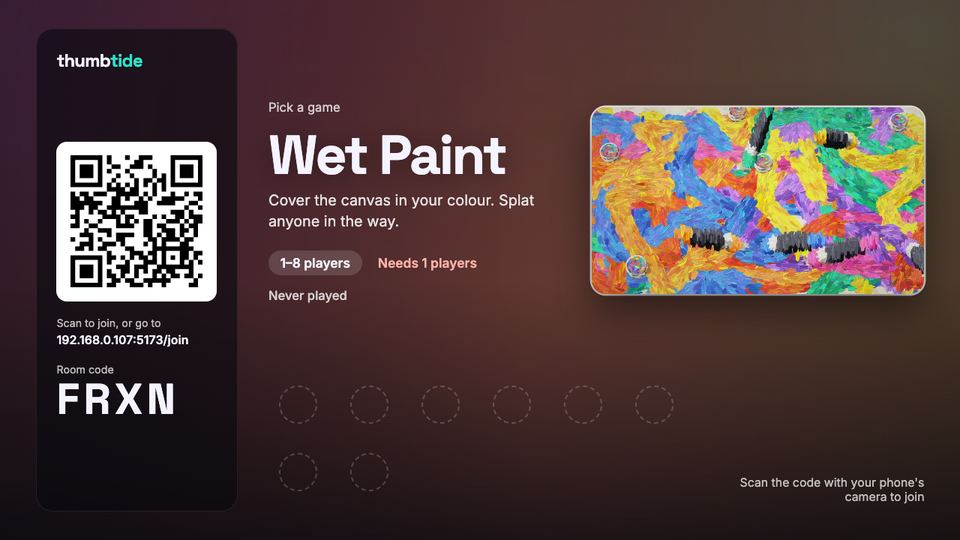
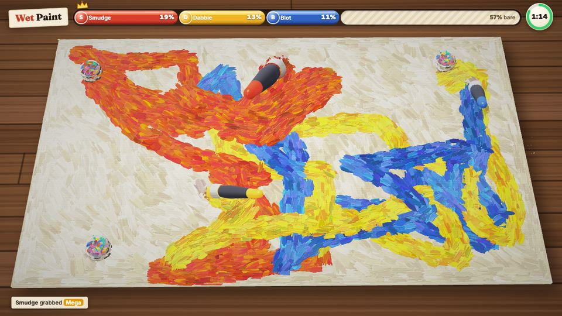
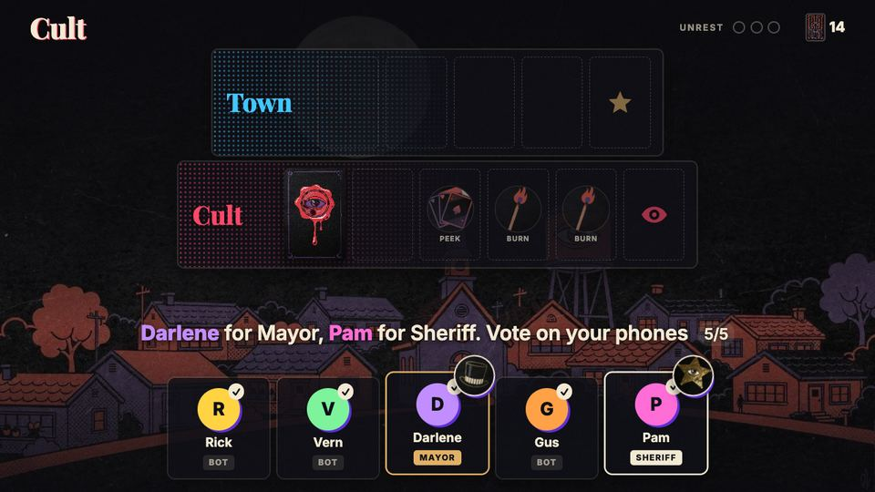
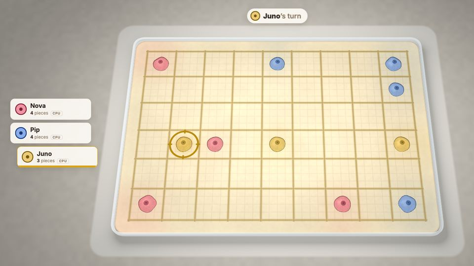
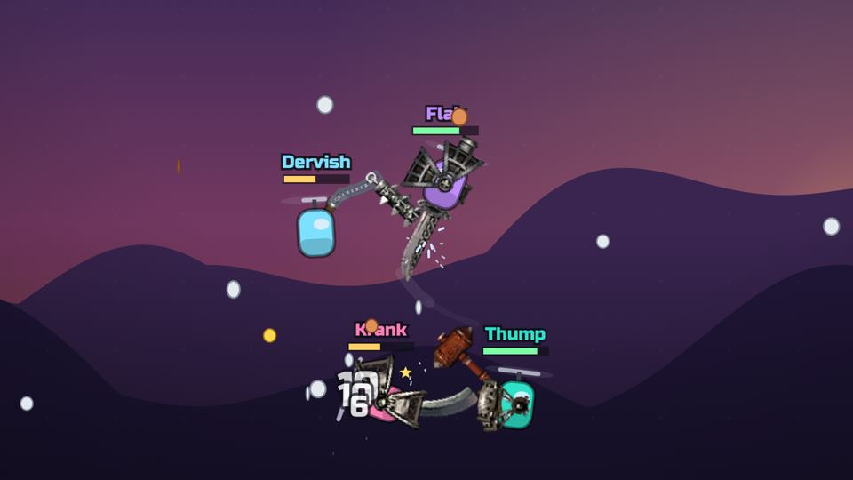
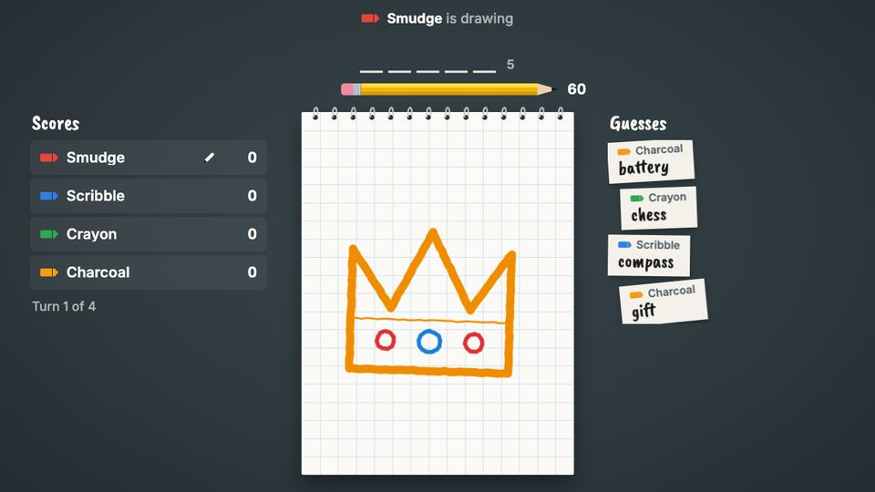

# Thumbtide

Party games on a big screen, played with phones as controllers. The TV (or any computer screen) shows the game, and
everyone joins from their phone's browser: scan the QR code, type a name, and your phone becomes the controller. No
app to install on the phones.



## The games

| | Game | Players | What it is |
|---|---|---|---|
|  | **Wet Paint** | 1–8 | Tiny brushes race to cover an oil-paint canvas in their colour |
|  | **Cult** | 5–8 (computers fill empty seats) | Hidden roles: the town votes in leaders while a secret cult tries to take over |
|  | **Cascade** | 1–8 | Turn-based chain reactions on a grid, in three looks: Culture, Marbles, Reactor |
|  | **Rotor Brawl** | 1–8 | Flying machines swing heavy weapons on rods and chains. Last one flying wins |
|  | **Inkling** | 1–8 | One player draws the secret word on their phone, everyone else guesses |

Every game can fill empty seats with computer players, so you can try any of them alone. Rules, settings and code
for each game: [docs/games.md](docs/games.md).

## Quick start

### You need

- A **Mac, Windows or Linux computer**. It runs the games and the server.
- **Node.js 22 or newer** ([nodejs.org](https://nodejs.org), or `brew install node` on a Mac). Check with `node -v`.
- **pnpm**: `npm install -g pnpm`
- **Phones on the same Wi-Fi** as the computer. Optional: a browser window can stand in for a phone.

### Install and run

```sh
git clone https://github.com/dupenodi/thumbtide.git
cd thumbtide
pnpm install
pnpm dev
```

`pnpm dev` keeps running until you press Ctrl+C. It starts:

- the **site** on port 5173: the TV page, the phone page and all the games
- the **relay** on port 8787: a small server that passes messages between the TV and the phones

### Play

1. Open **http://localhost:5173** on the computer. This is the TV screen: it shows a QR code and a room code.
   To play on a TV, see [Play on a TV](#play-on-a-tv).
2. **Scan the QR code** with each phone's camera, type a name and tap **Join**.
3. The first phone to join is the **host**. It shows the game library: pick a game, change its settings and tap
   **Play**. Everyone else's phone turns into that game's controller.
4. During a game, the host's phone has a **Host** button: pause, restart, settings, back to the lobby. On the
   computer, **Esc** opens the pause menu.

Sound on the TV page starts after the first click or key press there, because browsers block sound until then.

**No phone handy?** Open **http://localhost:5173/join/** in another browser window, switch on the browser's phone view
(Chrome: DevTools → the phone-and-tablet icon) and enter the room code. Each window is one player.

## Play on a TV

| TV | How |
|---|---|
| **Any TV with a computer plugged in** | Open the TV page in the computer's browser and make it full screen. Nothing else to set up |
| **LG TV** (webOS 6, 2021, or newer) | Install the LG app: `pnpm tv`. Setup: [docs/lg-tv.md](docs/lg-tv.md) |
| **Android TV / Google TV** (tested on a TCL, Android TV 14) | Install the Android app: `pnpm tv:android --tv=<TV IP>`. Setup: [docs/android-tv.md](docs/android-tv.md) |

The TV apps put the games on the TV itself, but they still need this computer running `pnpm dev` on the same Wi-Fi:
the relay runs here. The computer's address is built into the app, so rebuild the app if that address changes.

## If a phone can't connect

- **Same network.** The phone must be on the same Wi-Fi as the computer: not mobile data, and not a guest network
  (guest networks often keep devices apart).
- **Firewall.** The first time, macOS asks whether Node may accept incoming connections: click **Allow**. If you
  missed it, allow Node in *System Settings → Network → Firewall*. On Windows, allow Node through Windows Defender
  Firewall on private networks.
- **VPN.** The QR code points at the computer's local address (for example `http://192.168.1.20:5173/join/`). A VPN can
  make it pick the wrong one. Turn the VPN off and restart `pnpm dev`.
- **Ports in use.** If something else is using 5173 or 8787, `pnpm dev` stops with an error. Close the other program
  and try again.
- **"Can't reach the room"** after restarting `pnpm dev`: rooms live in the relay's memory, so a restart ends them.
  Reload the TV page to get a new room.

Without HTTPS, which the local setup doesn't have, phones can't use tilt sensors or keep the screen awake.
Everything else works.

## Commands

Run these from the repo root.

| Command | What it does |
|---|---|
| `pnpm dev` | Site and relay, with live reload: save a file and the TV page and phones update |
| `pnpm start` | The same as `pnpm dev`, and prints the TV and phone addresses. `--relay=8788 --web=5174` picks other ports |
| `pnpm test` | Relay, SDK and game-rule tests |
| `pnpm typecheck` | TypeScript check across the repo |
| `pnpm build` | Production build of the site into `web/dist` |
| `pnpm tv` | Build the LG TV app, install it and open it ([docs/lg-tv.md](docs/lg-tv.md)) |
| `pnpm tv:android --tv=<TV IP>` | Build the Android TV app, install it and open it ([docs/android-tv.md](docs/android-tv.md)) |
| `pnpm perf` | Frame-rate tests against the LG TV ([docs/development.md](docs/development.md#performance)) |

### Shortcuts for testing

Add these to the TV page's address:

- `/?game=cascade` opens a game straight away, without the lobby
- `&bots=3` adds computer players. `/?game=cult` with nobody joined plays itself with five computers
- any game setting works the same way, for example `&look=reactor`, `&timer=0` or `&round=20`
- `&quality=low` uses Wet Paint's and Cascade's lighter TV mode; `&lite=1` does the same for Rotor Brawl
- `/lab/cascade/` and `/lab/hammer/` are workbenches played with the mouse (only while `pnpm dev` runs)

The TV page remembers its room for the browser tab. Open a new tab or a private window for a fresh lobby.

## How it works

```
 phone ──┐                          ┌── TV page (the host)
 phone ──┼── WebSocket ── relay ────┤   runs all the game logic
 phone ──┘                          └── draws the game
```

- The **relay** (`server/`) creates rooms with four-letter codes, passes messages along and tracks who's connected.
  It knows nothing about games.
- The **TV page** (`web/`) owns the game: it reads the players' input, runs the rules and draws everything.
- **Phones** are controllers: they show what the TV tells them to and send input back.

| Folder | What's in it |
|---|---|
| `packages/protocol` | The messages the relay, TV and phones exchange |
| `packages/sdk` | Browser library: the TV side, the phone side, touch controls, haptics, QR codes |
| `server` | The relay (Node and `ws`) |
| `web` | The site: TV page, phone page (`join/`), shared shell (`src/shell/`) and the games (`src/games/`) |
| `web/tv` | The LG (`webos/`) and Android TV (`android/`) app wrappers |
| `tools/perf` | Frame-rate tools for the TV. Never shipped in an app |

## Docs

- [docs/games.md](docs/games.md): each game's rules, settings and code
- [docs/making-games.md](docs/making-games.md): how the platform works, and a step-by-step guide to adding a game
- [docs/notes.md](docs/notes.md): design rules, known issues and plans. Read it before designing a game
- [docs/lg-tv.md](docs/lg-tv.md): the LG TV app
- [docs/android-tv.md](docs/android-tv.md): the Android TV app
- [docs/development.md](docs/development.md): performance testing, art generation and deploying

## Credits

- Oil-paint brush rendering adapted from [Oil paint](https://patch.gg/blendi/oil-paint) by @blendi (MIT).
- Cascade's sound effects are from [Kenney](https://kenney.nl)'s Interface, Impact and Sci-fi sound packs (CC0).
- Rotor Brawl is a prototype of a licensed port of Hammerfight. Its sounds, music and weapon sprites are
  Hammerfight's own.
- Cult's art generated with FLUX.2 Pro via Replicate.
